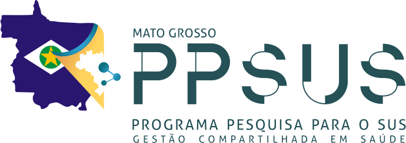
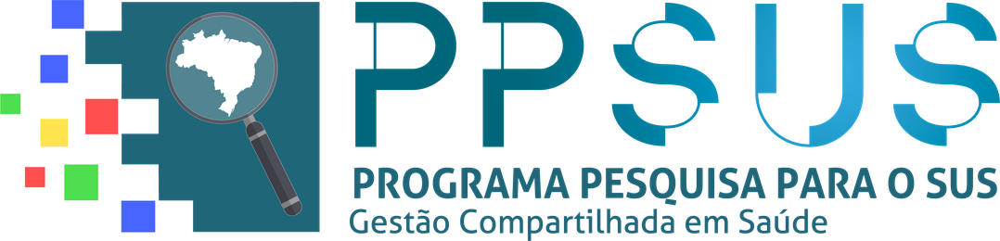
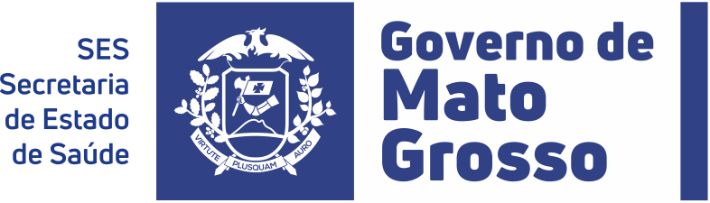

## O projeto

O projeto **Gestão integrada no SUS: avaliação da eficiência na oferta e previsão da demanda de serviços públicos de saúde em seus diferentes níveis de atenção nos municípios de Mato Grosso** foi aprovado no Edital PPSUS 004/2025 da Fundação de Amparo à Pesquisa do Estado de Mato Grosso (FAPEMAT), no âmbito do Programa Pesquisa para o SUS: gestão compartilhada em saúde (PPSUS), processo FAPEMAT-PRO.0001999/2025, com orçamento de R$ 199.655,00 e vigência de 27/11/2025 a 26/11/2027. A execução está a cargo da Universidade do Estado de Mato Grosso (UNEMAT), Campus de Sinop, em parceria com a Secretaria de Estado de Saúde de Mato Grosso (SES-MT).

A questão central que orienta a pesquisa pode ser enunciada de forma simples, embora a sua resposta seja complexa: **com os recursos de que dispõe, cada município de Mato Grosso produz o quanto poderia em cada nível de atenção, e quanta demanda deve esperar nos próximos anos?** Para respondê-la, o projeto organiza os dados públicos do Sistema Único de Saúde (SUS) em um repositório único, mede a eficiência por meio da Análise Envoltória de Dados (DEA, do inglês *Data Envelopment Analysis*), acompanha a evolução da produtividade com o índice de Malmquist e constrói modelos de previsão de demanda. Desde outubro de 2026, investigam-se também a localização de serviços, com vistas à redução do deslocamento dos pacientes, e a judicialização da saúde no estado.

## Objetivos

O projeto tem como objetivo geral avaliar a eficiência na oferta e prever a demanda de serviços públicos de saúde, em seus diferentes níveis de atenção, nos municípios de Mato Grosso. Para tanto, estabelecem-se os seguintes objetivos específicos:

1. Construir um repositório integrado (*Data Lake*) com os dados do SUS para os 142 municípios de Mato Grosso, no período 2020–2025.
2. Medir a eficiência técnica por meio da DEA em quatro camadas: os municípios, na atenção básica e na média complexidade; as regiões de saúde, na alta complexidade; e os hospitais SUS, por estabelecimento.
3. Acompanhar a evolução da produtividade entre 2020 e 2025 com o índice de Malmquist, de modo a distinguir os ganhos de eficiência das mudanças na tecnologia.
4. Prever a demanda por serviços de saúde por município e nível de atenção, com modelos estatísticos e de aprendizado de máquina.
5. Comparar cenários de localização de serviços de saúde que reduziriam o deslocamento dos pacientes, como apoio à discussão com a gestão do SUS (localização de serviços), a começar pelos pilotos de atenção ao parto e de Unidade de Terapia Intensiva (UTI) adulto.
6. Descrever a judicialização da saúde em Mato Grosso a partir dos dados públicos do Poder Judiciário (DataJud/CNJ) e verificar se ela se associa à oferta e à eficiência dos serviços.
7. Devolver os resultados aos gestores por meio de um aplicativo web, do qual este site constitui o primeiro passo, e de artigos e relatórios.

Os objetivos 5 e 6 foram incorporados ao projeto em outubro de 2026 e ampliam o plano de trabalho original. Os seus primeiros resultados, de caráter preliminar, encontram-se nas seções [Localização](localizacao/index.qmd) e [Judicialização](judicializacao/index.qmd).

## Produtos previstos

A Tabela 1 sintetiza os produtos previstos no plano de trabalho, o conteúdo de cada um e a respectiva situação. Observa-se que os produtos relativos à localização de serviços e à judicialização da saúde foram acrescentados posteriormente, em decorrência da ampliação dos objetivos.

**Tabela 1 – Produtos previstos do projeto e respectiva situação**

| Produto | Conteúdo | Situação |
|---|---|---|
| P1 · Data Lake do SUS-MT | Bases do SIOPS, CNES, SIA, SIH, SISAB, SI-PNI, SIM, SINASC e IBGE, tratadas e integradas | Em uso: alimenta as versões 0.1 a 0.5 deste site |
| P2 · Escores de eficiência (DEA) | Municípios × níveis de atenção, hospitais e regiões de saúde, 2020–2025 | Versão 2.1, de 16/10/2026 (atenção básica reestimada com o insumo de agentes comunitários restrito ao ACS; demais modelos da versão 2, de 08/10/2026), na seção [Eficiência](eficiencia/index.qmd); em validação com a SES-MT e o COSEMS-MT |
| P3 · Índice de Malmquist | Variação da produtividade 2020–2025 | Versão 2.1, de 16/10/2026 ([Produtividade](eficiencia/produtividade.qmd)); em validação |
| P4 · Previsão de demanda | Modelos por município e nível de atenção | Resultados preliminares de 17/10/2026 na seção [Previsão](previsao/index.qmd): internações por doenças respiratórias por região de saúde, com estimativa das semanas incompletas e alerta; especificação em validação |
| P5 · Aplicativo web | Este observatório, ampliado com os escores e as previsões | Versão 0.5 (24/10/2026) |
| P6 · Artigos e relatórios | Publicações científicas e relatórios técnicos | Previsto |
| Localização de serviços (incorporada em outubro de 2026) | Acesso atual, demanda projetada e cenários de localização de serviços para apoiar a discussão | Pilotos de atenção ao parto e UTI adulto, resultados preliminares de 17/10/2026 na seção [Localização](localizacao/index.qmd) |
| Judicialização da saúde (incorporada em outubro de 2026) | Ações judiciais de saúde por comarca, previsão de curto prazo e fatores associados (DataJud/CNJ) | Resultados preliminares de 17/10/2026 na seção [Judicialização](judicializacao/index.qmd) |

::: {.nota-fonte}
Fonte: elaboração própria.
:::

## Recorte

O recorte territorial compreende os **142 municípios** de Mato Grosso, entre os quais Boa Esperança do Norte, instalado em 2025, que integra as tabelas a partir desse ano. Os municípios organizam-se em **16 regiões de saúde**, correspondentes às Comissões Intergestores Regionais (CIR), e em **6 macrorregiões**, conforme o Plano Diretor de Regionalização (PDR). A janela analítica corresponde ao período **2020–2025**, no qual todas as fontes coincidem com qualidade aceitável, conforme se detalha em [Metodologia](metodologia.qmd).

## Equipe

A equipe do projeto é composta pelos seguintes integrantes:

- **Coordenação:** Prof. Lindomar Pegorini Daniel (UNEMAT, Campus de Sinop)
- Udilmar Zabot (UNEMAT)
- Felipe Vazquez (UNEMAT)
- Luceni Grassi (SES-MT)
- Vitor Benfica (ciência de dados)
- Paulo Freitas Filho (UFMT)
- Feliciano Azuaga
- Marcos Oliveira (software)
- Felisberto Edgar Gomes (bolsista de iniciação científica)

## Cronograma resumido

A Tabela 2 apresenta os principais marcos do projeto e das versões do Observatório. As etapas seguem o plano de trabalho aprovado, e o site é atualizado a cada etapa concluída.

**Tabela 2 – Cronograma resumido do projeto e do Observatório**

| Marco | Situação |
|---|---|
| Vigência do projeto: 27/11/2025 a 26/11/2027 | Em andamento |
| Versão 0.1 do observatório: dados e indicadores 2020–2025 e análise de deslocamento | Publicada em 30/09/2026 |
| Versão 0.2: escores de eficiência (DEA) e índice de Malmquist (resultados da versão 2 da estimação) | Publicada em 08/10/2026; em validação com a SES-MT e o COSEMS-MT |
| Versão 0.2.1: resultados da versão 2.1 da estimação de eficiência (atenção básica reestimada com o insumo de agentes comunitários restrito ao ACS, CBO 515105) | 16/10/2026; em validação com a SES-MT e o COSEMS-MT |
| Versão 0.3: internações de residentes de Mato Grosso em hospitais de outros estados (SIH/SUS das outras 26 unidades da federação), na página de deslocamento | 16/10/2026 |
| Versão 0.4: previsão de demanda das internações por doenças respiratórias, localização de serviços (pilotos de atenção ao parto e UTI adulto) e judicialização da saúde (DataJud/CNJ), em seções próprias | 17/10/2026; resultados preliminares |
| Versão 0.5: revisão dos textos em linguagem científica, sem alteração dos valores ou dos resultados | 24/10/2026 |
| Versão final dos modelos de previsão de demanda, depois da validação da especificação; ampliação do aplicativo | Previsto |
| Artigos, relatórios e devolutiva aos gestores | Previsto |

::: {.nota-fonte}
Fonte: elaboração própria.
:::

## Realização e financiamento

O projeto é executado pela UNEMAT — Universidade do Estado de Mato Grosso, Campus de Sinop, e financiado pelo Programa Pesquisa para o SUS: gestão compartilhada em saúde (PPSUS) — Edital FAPEMAT nº 004/2025, processo FAPEMAT-PRO.0001999/2025 — com recursos da FAPEMAT, do CNPq, do Decit/SECTICS/Ministério da Saúde e da SES-MT.

**Realização**

::: {.logos-realizacao}
[ ]{.rodape-rotulo} 
:::

**Financiamento**

::: {.logos-realizacao}
     
:::

[As logomarcas são empregadas em cumprimento à cláusula 7ª, §3º, do Termo de Concessão, que torna obrigatória a referência ao apoio da FAPEMAT, do CNPq e do Decit/SECTICS/MS em toda divulgação. A origem de cada arquivo encontra-se documentada em `assets/logos/FONTES.md`, no código-fonte.]{.nota-fonte}

## Sobre este site

O site é atualizado a cada etapa concluída do projeto, e as suas versões registram a incorporação progressiva dos resultados. A versão 0.1 publicou os dados e indicadores de 2020–2025 e a análise de deslocamento entre residência e atendimento nas internações. A versão 0.2 acrescentou os escores de eficiência (DEA) e a produtividade (Malmquist) dos municípios, dos hospitais SUS e das regiões de saúde, com fichas destinadas ao gestor, correspondentes aos resultados da versão 2 da estimação, em validação com a SES-MT e com o Conselho de Secretarias Municipais de Saúde de Mato Grosso (COSEMS-MT). A versão 0.2.1 incorporou a versão 2.1 da estimação, na qual o modelo de atenção básica foi reestimado com o insumo de agentes comunitários de saúde restrito ao ACS (CBO 515105), mantidos inalterados os demais modelos. A versão 0.3, por sua vez, acrescentou à análise de deslocamento as internações de residentes de Mato Grosso em hospitais de outros estados, medidas com o SIH/SUS das outras 26 unidades da federação.

A versão 0.4 acrescentou, em seções próprias e em caráter preliminar, a previsão de demanda das internações por doenças respiratórias, a localização de serviços de saúde (pilotos de atenção ao parto e de UTI adulto) e a judicialização da saúde, analisada a partir dos dados públicos do DataJud/CNJ. Cumpre destacar que esses resultados se destinam à discussão de métodos e cenários com a gestão e não constituem recomendação oficial. Por fim, a versão 0.5 revisou os textos do site em linguagem científica, sem alteração dos valores ou dos resultados.

Quanto à proteção dos dados, publicam-se somente agregados por município, região de saúde, comarca ou estabelecimento, sendo os hospitais identificados pelo nome fantasia e pelo código do Cadastro Nacional de Estabelecimentos de Saúde (CNES), que constitui dado público. Nenhum microdado é divulgado. Além disso, nos recortes com contagens pequenas, não são publicados os valores de 1 a 4, nem as células que permitiriam deduzi-los.

No que se refere à produção, o site é gerado com o [Quarto](https://quarto.org) e com a linguagem R a partir dos painéis do *Data Lake* do projeto e, na versão 0.4, também de agregados das frentes de previsão, localização e judicialização, que empregam fontes externas como o DataJud/CNJ e o OpenStreetMap; a publicação é feita no GitHub Pages, e o código-fonte encontra-se em [github.com/daniellindomar/ppsus](https://github.com/daniellindomar/ppsus). Eventuais erros ou sugestões podem ser comunicados por meio do link "Criar uma issue", no menu do GitHub, ou por mensagem à coordenação.

**Contato:** lindomar.pegorini@unemat.br

**Como citar:** DANIEL, L. P. et al. *Observatório PPSUS-MT: dados, indicadores e eficiência do SUS nos municípios de Mato Grosso*. Versão 0.5. Sinop: UNEMAT, 2026. Disponível em: https://daniellindomar.github.io/ppsus/. Projeto PPSUS 004/2025 FAPEMAT.

O conteúdo, os indicadores e os arquivos derivados estão sob a licença [CC BY 4.0](https://creativecommons.org/licenses/by/4.0/deed.pt-br), que permite o uso livre com citação do projeto, **exceto** os arquivos e os gráficos derivados do DataJud/CNJ (arquivos `judicializacao_*` e aba [Judicialização](judicializacao/index.qmd)), que seguem o Termo de Uso da API Pública do DataJud e admitem somente uso não comercial (itens 3.3 e 3.8). Os dados de origem são públicos (DATASUS, SIOPS, IBGE e, nas seções da versão 0.4, também SIVEP-Gripe, INMET, InfoDengue, OpenStreetMap e DataJud/CNJ), e as condições de cada fonte estão descritas em [Dados](dados/index.qmd#licenca).
